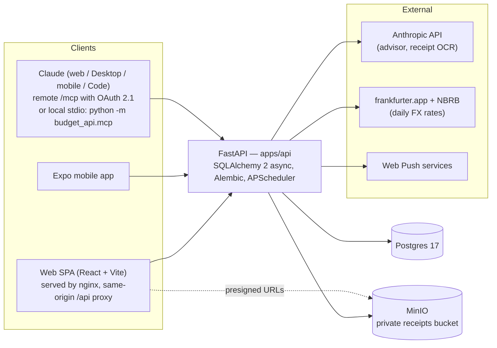

# Budget

A self-hosted personal budget for people who live in more than one currency: accounts, transfers, receipts, bank-statement import, goals as plans, debts, deposits, recurring operations — and an AI layer (advisor, receipt OCR) that is opt-in and talks to Claude. One FastAPI backend serves a React web app, an Expo mobile app and AI clients over MCP. The codebase is developed by a team of AI agents orchestrated in Claude Code, with a documented review trail per scope.

*Кратко по-русски: мультивалютный личный бюджет (счета, переводы, чеки, импорт выписок, цели-планы, долги, депозиты, повторяющиеся операции) с AI-слоем и MCP-доступом для Claude; один API на веб, мобилку и AI-клиентов; разрабатывается командой AI-агентов под управлением владельца.*

## The problem

Tracking spending across BYN, USD, EUR and RUB accounts (plus the odd receipt in another currency) breaks most budgeting apps: amounts get re-converted at today's rate, float rounding creeps in, and a bank export has to be reconciled by hand. Budget takes a stricter stance:

- Money is stored as **integer minor units** with a per-currency exponent table (JPY = 0, BHD = 3, default 2). No floats, and clients never do money arithmetic — every aggregate and conversion arrives from the server as a response field.
- Each transaction keeps a **snapshot** of its base-currency value at write time; a user-entered override always beats the automatic conversion.
- Beyond the ledger: receipts (upload + OCR), bank-statement import with matching and idempotent re-import, goals that are **plan trees** with attachments and plan-vs-fact progress, debts (lent and borrowed) booked on real accounts, deposits with interest accrual, recurring operations and category limits, an SSE-streamed advisor, web push reminders, CSV export.
- The same API is exposed to AI clients through **MCP**: a remote connector with OAuth 2.1 (nothing to install) or a local stdio server with a personal access token.

Four base currencies are selectable (`USD`, `EUR`, `RUB`, `BYN` — `packages/shared/src/currencies.ts`); accounts and transactions can carry any three-letter currency code (the exponent table decides its minor unit), with conversion available for the pairs the FX jobs fetch (frankfurter.app for EUR crosses, the National Bank of Belarus for BYN/RUB).

## Architecture



Production is the same set of containers behind Caddy (TLS) → nginx → api; only Caddy publishes ports (`docker-compose.prod.yml`, `docs/deploy.md`).

### Monorepo layout

```
budget/
├── apps/
│   ├── api      — FastAPI backend (Python 3.12, uv), MCP server and OAuth server inside the same process
│   ├── web      — Vite + React SPA (nginx image proxies /api, /storage, /mcp)
│   └── mobile   — Expo (React Native) app — MVP, frozen
├── packages/
│   ├── shared     — money/date formatting, currency exponents, zod schemas, palette (web + mobile)
│   └── api-client — OpenAPI-generated TS types + typed fetch client
├── deploy/      — Caddyfile, bootstrap/update/backup/restore scripts
├── docs/        — mini-docs the agents read before touching code
└── .tasks/      — per-scope artefacts: task, plans, QA checklists, reviews, meta-reviews
```

### Stack

| Layer | Choice |
|---|---|
| API | FastAPI, SQLAlchemy 2 (async, asyncpg), Alembic — 17 migrations in `apps/api/alembic/versions`, fastapi-users (JWT + refresh tokens), slowapi rate limits, APScheduler |
| Storage | Postgres 17, MinIO (S3 presigned PUT/GET, private bucket) |
| AI / MCP | `anthropic` SDK, `mcp` SDK (Streamable HTTP + OAuth 2.1 authorization server in-process) |
| Web | React, Vite, react-router, TanStack Query, Zustand, react-hook-form + zod, Recharts |
| Mobile | Expo, expo-router, TanStack Query, Zustand |
| Tooling | pnpm workspaces + Turborepo, uv, ruff, pyright (strict), vitest, pytest |

## Features

Everything below is marked done in `PLAN.md`; the mobile app is an MVP frozen at the stage noted there (auth, transactions, categories, summary, accounts and transfers; receipts, charts and offline mode are not implemented on mobile).

- **Ledger, accounts, transfers** — categories (18 system + user-defined, archived rather than deleted), transactions with filters, search and sort, accounts (card/cash) with server-computed balances, transfers as one row with both legs; transfers and debt movements are excluded from every money aggregate at a single point.
- **Currencies and FX** — daily rates from frankfurter.app and NBRB with catch-up on boot, `Decimal` math, nearest-previous-date lookup, per-transaction base-currency snapshot, switching the base currency is display-only.
- **Goals as plans** — a goal is a tree of items with amounts rolling up bottom-up, inherited deadlines, reminders, photo attachments, and real transactions linked to nodes (paid / saved / remaining to find are three separate numbers); realism check against the free balance of the last three months.
- **Debts** — lent and borrowed, principal and repayments booked as real movements on accounts, overpayment refused under a row lock, due dates feed the push digest.
- **Deposits** — a deposit is a hidden ledger account; interest (actual/365, capitalization none/monthly/quarterly/at maturity, optional tax) is computed per read from the transfer timeline, with a manual anchor the user may set.
- **Recurring operations and category limits** — templates materialised daily by watermark, upcoming charges, per-category monthly limits with spent indicators.
- **Receipts** — upload via presigned URL, OCR through Claude into strict JSON, confirmation form (no silent auto-booking), merchant → category auto-categorisation learned from confirmed transactions.
- **Bank-statement import** — Priorbank CSV and Credo XLSX parsers, exact/similar/new matching against existing rows, per-row decisions, bulk apply in one DB transaction, "replace a date range" with a confirmation that is checked against the actual deletion; re-import is duplicate-free by construction (fingerprint `client_id` per row).
- **Statistics and advisor** — per-category, monthly series, period comparison, top merchants; `POST /advisor/ask` streams Claude's answer over SSE from a compact aggregate context, with a daily rate limit.
- **Web push** — VAPID subscriptions, a daily digest (names only, never amounts) for goal deadlines, charges, deposits maturing and debts due.
- **CSV export** — streamed, BOM + RFC 4180, transfers included.
- **MCP** — 40 tools derived from the API routes, two modes (read / full), remote connector with OAuth 2.1 or local stdio server (see below).
- **Web app** — all of the above, plus Settings with personal access tokens and connected AI apps; RU/EN i18n; light/dark palette shared with mobile.

Not done: OAuth sign-in (Google/Apple), mobile offline mode (groomed, not started), mobile receipts/charts.

## Key invariants

From `docs/conventions.md`; each is pinned by a test.

- **Integer minor units** everywhere, exponent table in two twins (`domain/money.py` and `packages/shared/src/currencies.ts`) that a sync test keeps identical. Never hard-code ×100.
- **FX is `Decimal`** (ROUND_HALF_UP); transactions store a base-currency snapshot; a user-supplied converted value is an override and wins; PATCH semantics are omit = keep, value = override, null = recompute. Unconvertible rows are surfaced as `unconverted` counts, not dropped.
- **Every query is scoped by `user_id`.** A foreign id and a missing id go through one code path to a byte-identical 404 (no existence oracle); guard order is chosen so that, say, a foreign archived account answers 404, never "archived".
- **The contract is a pair**: `apps/api/openapi.json` and `packages/api-client/src/generated/schema.d.ts` are regenerated together by `pnpm openapi` and committed in the same change; a drift test in `api-client` regenerates and diffs, so a stale pair fails `pnpm test` and CI.
- **System categories have frozen UUIDs** in migration `0003` — a contract across environments and clients, never regenerated.
- Error bodies are string codes (`detail: "ACCOUNT_NOT_FOUND"`), 422s are declared as an honest `anyOf` of domain error and validation error, streaming routes never advertise a fake JSON 200.

## Quick start

One command brings up Postgres, MinIO, the API and the web app. Migrations run as part of the API container's start, so a fresh machine needs nothing else:

```bash
docker compose up -d --build
```

| Service | URL | Notes |
|---|---|---|
| Web app | http://localhost:5173 | static build served by nginx; `/api`, `/storage`, `/mcp` proxied same-origin |
| API | http://localhost:8010 | `/health` answers `{"status":"ok",...}` |
| MinIO console | http://localhost:9011 | `minioadmin` / `minioadmin` |
| Postgres | localhost:5443 | set `POSTGRES_HOST_PORT=5443` in a root `.env`; the compose default is 5433 |

Ports are env-overridable (`WEB_HOST_PORT`, `API_HOST_PORT`, `POSTGRES_HOST_PORT`). The backend test suite and the local-dev defaults expect Postgres on **5443**, which is why the table says so. `docker compose down` stops everything and keeps the data; images are built, not mounted, so after a code change run `docker compose up -d --build api web`.

**AI features.** The advisor and receipt parsing answer an honest `503 AI_NOT_CONFIGURED` until an `ANTHROPIC_API_KEY` exists. Put it in the root `.env` (gitignored) and recreate the API container with `docker compose up -d api`. Web push likewise stays off until the three `VAPID_*` variables are set.

**Why MinIO listens on 9010 inside the container too.** Presigned upload/download URLs are signed together with their host, and both the browser and the API must be able to reach that host. One alias, `minio.localhost:9010`, satisfies both: browsers resolve `*.localhost` to 127.0.0.1 and land on the published port, while inside the compose network the alias resolves to the container. nginx rewrites those links to `/storage/…` for the SPA so the signature stays valid.

### Developing without Docker

Prerequisites: **Node 22** (`.nvmrc`, `nvm use`), **pnpm** via corepack (pinned by `packageManager` in `package.json`: `corepack enable pnpm`), **uv** (it provisions Python 3.12 itself).

```bash
pnpm install                      # all workspaces
pnpm lint && pnpm typecheck && pnpm test   # turbo across web / mobile / shared / api-client

pnpm --filter @budget/web dev     # Vite dev server
pnpm --filter @budget/mobile dev  # Expo dev server

cd apps/api
cp .env.example .env              # DATABASE_URL, JWT_SECRET
uv sync                           # Python environment
uv run uvicorn budget_api.app:create_app --factory --reload --port 8010
uv run pytest                     # needs the compose Postgres on 5443 with the budget_test database
```

`uv run pytest`, `alembic` and the dev server run from `apps/api` (the `.env` is resolved relative to the working directory). The `budget_test` database is created by `docker/postgres/init/` on first initialisation of the Postgres volume; `TEST_DATABASE_URL` overrides the default.

**Regenerating the API client.** After any change that alters the schema (routers, schemas, app metadata):

```bash
pnpm openapi   # from the repo root: exports apps/api/openapi.json, then generates schema.d.ts
```

Commit both files together with the API change. Never hand-edit anything under `src/generated/`. The export is hermetic — no `.env`, database or running server — but it needs uv.

**Do not "fix" these.**

- `apps/mobile/tsconfig.json` extends `expo/tsconfig.base`, not the root `tsconfig.base.json`. Expo's base conflicts with the root base; shared strictness across the repo is a convention upheld by hand, not something mobile inherits.
- Root `.npmrc` sets `node-linker=hoisted`. The flat `node_modules` layout is required for Expo/Metro to resolve dependencies in a pnpm monorepo.

## Tests and CI

At the time of writing (2026-10-14, local run):

| Suite | Tests | Notes |
|---|---|---|
| `apps/api` pytest | 746 | against a real Postgres: the suite applies `alembic upgrade head` itself, external seams (object storage, FX providers, push sender, Anthropic client) are stubbed, schedulers off |
| `packages/shared` vitest | 133 | money/date/currency logic |
| `packages/api-client` vitest | 76 | includes the `openapi.json` ↔ `schema.d.ts` drift test |
| `apps/web` vitest | 274 | hooks, forms, pure view logic |
| `apps/mobile` vitest | 95 | node-testable modules only |

Two GitHub Actions workflows in `.github/workflows/`:

- **`ci-api.yml`** — `uv sync --frozen` → `ruff check` + `ruff format --check` → `pyright` (strict) → `alembic upgrade head` + `alembic check` (models vs migrations) → `pytest`, against a `postgres:17-alpine` service container.
- **`ci-js.yml`** — `pnpm install --frozen-lockfile` → `turbo lint typecheck test` for web, mobile, shared and api-client.

Both are path-filtered, cache their dependencies, cancel in-progress runs on the same ref, pin actions to commit SHAs and run with `permissions: contents: read`. The workflows were added in the current scope; the first run on GitHub is still pending, so there is no status badge yet.

## MCP: Claude as a client

Two ways to connect, same tools either way (`apps/api/MCP.md` is the user guide, `docs/mcp.md` the map for engineers):

1. **Remote connector** — paste `https://<your-domain>/mcp` into Claude (web, Desktop, mobile) or `claude mcp add --transport http budget https://<your-domain>/mcp` in Claude Code. The API hosts its own OAuth 2.1 authorization server: dynamic client registration, PKCE, refresh-token rotation with family revocation, and a consent page where the user picks **read** or **full** mode. Grants are listed and revoked in Settings → Connected AI apps; revocation is immediate. Nothing to install.
2. **Local stdio server** — `python -m budget_api.mcp` with a personal access token issued in Settings; the only local-only extra is `upload_receipt` (reads a JPEG from a directory on the machine running the server).

Tools are derived from `@mcp_tool` markers on the API route handlers: the same marker that lets a token reach a route is what publishes it as a tool, so "reachable by a token" and "visible to the model" cannot disagree, and an unmarked route is unreachable by any token and invisible as a tool (fail-closed). The snapshot in `apps/api/tests/fixtures/mcp_tools_snapshot.json` pins **40 tools** (22 read, 18 write) plus `upload_receipt`; a read grant sees only the 22. Deliberate exclusions (bulk statement apply/replace, deposit creation, deleting goal items or debts) are marked `# MCP: no` next to the route with the reason. Every tool call goes through the real request path — audit log, rate limits, no-oracle 404s — and the server does no money arithmetic of its own.

## Built by a team of AI agents

The owner acts as product manager and orchestrator in Claude Code; the code is written, tested and reviewed by specialised agents defined in `.claude/agents/`:

| Role | Does |
|---|---|
| `senior-lead` | Restates the task, selects the team, resolves disagreements, reads **every engineer diff before QA** ("diff gate", never skipped at any tier), writes the meta-review on the reviewer's findings, updates `docs/` at scope close |
| `architect` | Only for new tables, modules or contract changes: schema, dependency direction, trade-offs → `architecture.md` |
| `backend-engineer` | `apps/api`: implementation plan, code, pytest |
| `frontend-engineer` | `apps/web` and shared packages: plan, code, vitest |
| `mobile-engineer` | `apps/mobile` (Expo) |
| `qa-engineer` | API-level checklist (pytest list + curl), runs it against a live server |
| `web-qa` | Browser user journeys against the dev server |
| `mobile-qa` | Simulator runs plus an explicit manual-device checklist |
| code-reviewer | Dispatched as a general-purpose agent at the review stage; reviews code, does not re-run the gates |

**Review tiers.** Each scope is classified at grooming time. **FULL** (groom → implement → diff gate → QA → code-reviewer → meta-review) is triggered by auth/security, money math, DB migrations, external integrations and API contract changes. **STANDARD** drops the formal reviewer (engineer self-review instead); **FAST** is for trivial pattern repeats, tests still mandatory. The orchestrator reviews the final code on top of all of this.

**Artefact trail.** Every scope leaves `.tasks/<scope>/` with `task.md`, `grooming-review.md`, `architecture.md` (when an architect was involved), `plan*.md`, `qa-*checklist.md`, `review*.md` and `meta-review*.md`. Agents read the mini-docs in `docs/` (backend, web, mobile, infra, deploy, conventions, mcp) before opening source files; `PLAN.md` is the roadmap and the single source of truth for status.

### Defects the review stage actually caught

Real findings from code-reviewer, confirmed and fixed under the lead's meta-review; each file records the verdict per finding.

| Scope and file | Finding |
|---|---|
| `.tasks/debts/meta-review.md` MAJOR-1 | The repayment edit took its `FOR UPDATE` row lock after the router had already read the amount, so two concurrent edits of one repayment could push the remaining debt below zero. Fix: lock first, then re-read. |
| `.tasks/web-push/meta-review.md` MAJOR-1 | The push sender used `requests` with redirects enabled, so the endpoint allow-check bound only the first hop, and `POST /push/test` became a three-way status oracle for any attacker-controlled host. Fix: a no-redirect session; 3xx counts as failed. |
| `.tasks/statement-import/meta-review-s1.md` MAJOR-1, MAJOR-2 | Matching let a value match steal another row's `client_id` match (lost operation + duplicate on apply), and the candidate window was narrower than the data, guaranteeing a duplicate on the period boundary. Both pinned by tests that fail without the fix. |
| `.tasks/mcp-decorators/meta-review.md` MAJOR-1 | `upload_receipt` treated a 3xx from object storage as success — "receipt uploaded" with no object behind it. The lead notes its own diff gate missed the second status check. |
| `.tasks/web-auth-flow/meta-review.md` MAJOR | A cross-tab logout race in `runRefresh` spent a deliberately revoked refresh token. The lead had graded it cosmetic at the diff gate and accepts the reviewer's harder grade; the "Disagreements with the reviewer" section then tightens two findings beyond what the reviewer asked for. |
| `.tasks/currencies-goals/meta-review-s4-s5.md` BLOCKER | `suggested_deadline` could compute a year beyond `date.max` for a near-break-even user, turning the whole `/goals` read surface into a deterministic 500. Fix: nullable result with a year guard. |
| `.tasks/accounts-and-transfers/meta-review-b1.md` MAJOR-1 | `PATCH /transactions/{id}` with an explicit `"counter_amount_minor": null` on a non-transfer slipped past validation and died on an assert (500). Fix: decide by `model_fields_set`, 422 for both null and value. |

The lead does not rubber-stamp in either direction: `.tasks/stats-advisor/meta-review-b2.md` records a finding where the reviewer's premise about rate-limit namespaces was wrong, and the lead rules "the grooming-time premise was wrong, not the implementation" and replaces the vacuous test with a unit arm that pins the real property.

## Evals

An `ai-layer` scope (LLM categorisation with confidence and rationale, manual review below a threshold during import, evals on an anonymised operation set with replay in CI — `PLAN.md` 7.1) is in progress. No accuracy numbers are published until a real run exists.

## Privacy

- Single-tenant, self-hosted: your data lives in your own Postgres and MinIO; receipts are in a private bucket reachable only through short-lived presigned URLs.
- AI features are off until you set `ANTHROPIC_API_KEY`. The advisor sends a compact context of aggregates and goals — never raw transactions (an import-graph property checked in review). Receipt parsing sends the image to the Anthropic API.
- Push digests carry names only; the payload type has no amount or currency field.
- MCP access is per token or per OAuth grant, in read or full mode, revocable immediately from Settings; every token request is audited with the route template, never the raw URL.
- QA runs use dedicated `qa-*@budgetqa.dev` accounts, never a real user's data.

## Status and roadmap

`PLAN.md` carries the stage-by-stage status (stages 0–7) and what is next; `docs/deploy.md` describes the production layout, backups and secret rotation.
